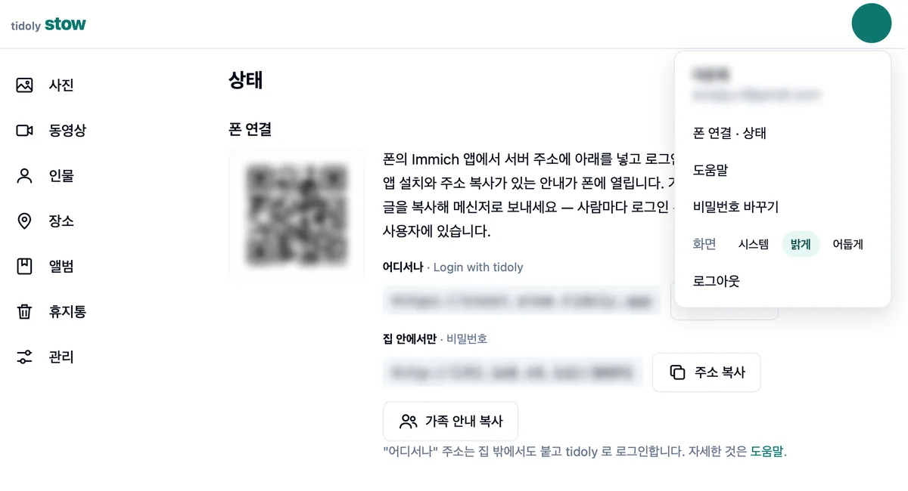
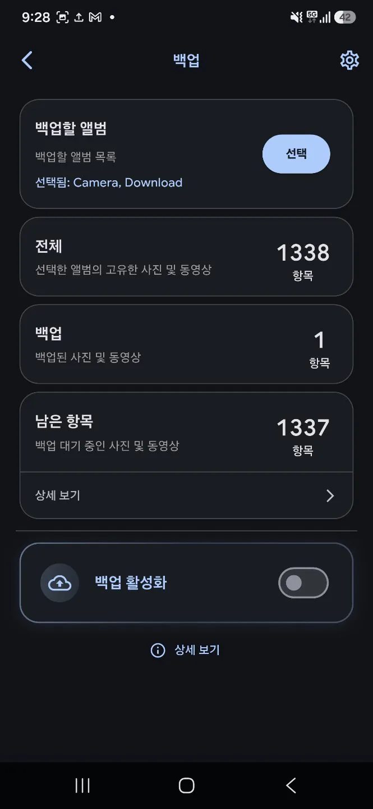

# tidoly stow

**휴대폰 사진을 집 PC 로 백업하는 사진 서버입니다.** 클라우드 용량을 사지 않아도 됩니다.

| 🐳 **Docker 없이 설치** | 💾 **사진은 내 PC 에** | 📱 **휴대폰 사진을 PC 로 백업** |
|---|---|---|
| 윈도는 설치 파일 하나, 맥 · 리눅스는 명령 한 줄. Docker · 데이터베이스 서버 · 서버 설정이 필요 없습니다. | 원본은 이 PC 의 하드에만 있습니다. 클라우드에 올리지 않고, 얼굴 · 장소로 정리하는 것도 이 PC 안에서 합니다. | [Immich](https://immich.app) 앱에서 서버 주소를 넣거나 QR 을 찍으면 사진 · 동영상이 이 PC 로 올라옵니다. |

<p>


</p>

> tidoly stow 는 Immich 와 별개의 프로그램입니다. Immich 앱이 쓰는 서버 API 를 따로 구현했고, Immich 팀과는 관계가 없습니다.

## 할 수 있는 것

- **휴대폰 백업** — Immich 앱에서 서버 주소만 넣으면 사진 · 동영상이 이 PC 로 올라옵니다. Android 앱으로 시험했습니다.
- **웹에서 보기** — 사진 · 동영상 · 인물 · 장소 · 앨범 · 휴지통. 공유 사진은 이 서버의 다른 가족에게도 보입니다.
- **가족 계정** — 사람마다 계정과 저장 위치를 따로 둡니다.
- **기존 사진 폴더** — PC 에 이미 있는 폴더를 옮기지 않고 그 자리에서 읽습니다.
- **자동 정리** — 얼굴로 인물을 묶고, 좌표로 장소 이름을 붙이고, 바코드가 있는 그림을 "쿠폰" 앨범에 모읍니다. 모두 이 PC 안에서 합니다.
- **집 밖에서 접속** — tidoly 터널(베타, tidoly 계정으로 로그인) 또는 WireGuard VPN(공유기 포트 하나를 열 때).
- **업데이트 알림** — 새 버전이 나오면 관리 화면에 알리고, 맥 · 윈도는 단추 하나로 바꿉니다.

## 설치

[최신 릴리스](https://github.com/tidoly-com/stow/releases/latest)에서 받습니다.

| | |
|---|---|
| **macOS** (Apple Silicon · Intel) | `curl -fsSL https://github.com/tidoly-com/stow/releases/latest/download/stow-macos.sh \| sh` |
| **Windows** (x64) | `stow-install.exe` 를 받아 실행 — 서명이 없어 SmartScreen 이 경고하면 "추가 정보 → 실행" |
| **Linux** (amd64, systemd) | `curl -fsSL https://github.com/tidoly-com/stow/releases/latest/download/stow-linux.sh \| sudo sh` |

처음 열면 사진을 둘 폴더와 관리자 계정을 정하고, 화면의 QR 로 휴대폰을 붙입니다. 쓰는 법은 앱 안의 **도움말**에 있습니다.

- 서버는 포트 **30891** 을 씁니다. 휴대폰은 이 PC 와 같은 와이파이에서 `http://<이 PC 주소>:30891` 로 붙습니다.
- 사진과 함께 DB 와 작은 그림이 사진 폴더 안의 숨김 폴더 `.stow/` 에 있습니다. 백업은 이 폴더 전체를 다른 디스크에 복사하면 됩니다 — tidoly stow 가 따로 백업하지 않습니다.
- 얼굴 묶기는 Apple Silicon 맥 · Windows · Linux 에서 됩니다(인텔 맥은 안 됩니다). 쿠폰의 유효기간 읽기는 맥에서만 됩니다.

## 소스에서 빌드

Go 1.26 이 필요합니다.

```sh
go test ./...
go build -o tidoly-light ./cmd/tidoly-light
./tidoly-light -data ./data          # http://127.0.0.1:30891
```

| | |
|---|---|
| `cmd/tidoly-light` | 사진 서버 |
| `cmd/stow` | 맥 · 윈도의 창과 메뉴 막대 · 트레이 |
| `cmd/stow-faces` | 얼굴 도우미 (ONNX Runtime · YuNet · SFace) |
| `cmd/stow-install` · `cmd/stow-uninstall` | 윈도 설치 · 지우기 |
| `internal/immich` | Immich 앱이 쓰는 API · 동기화 · 로그인 |
| `internal/web` | 웹 화면 (서버가 그리는 HTML + 프레임워크 없는 JS) |
| `internal/store` | SQLite |
| `helpers/coupons-mac` | 쿠폰 글자 읽기 도우미 (macOS Vision) |
| `scripts/` | 앱 · 릴리스 빌드와 설치 스크립트 |

릴리스 파일은 `scripts/release-mac.sh` · `release-windows.sh` · `release-linux.sh` 로 만듭니다.

## 라이선스

[AGPL-3.0](LICENSE). 고쳐서 서비스로 띄우면 고친 소스를 공개해야 합니다.
"tidoly" 와 "tidoly stow" 이름 · 아이콘은 라이선스에 들어 있지 않습니다 — [TRADEMARKS.md](TRADEMARKS.md).
함께 들어가는 FFmpeg(LGPL) · ONNX Runtime · 얼굴 모델 · Go 모듈의 고지는 앱의 **오픈소스 라이선스** 화면과 `assets/licenses/` 에 있습니다.
